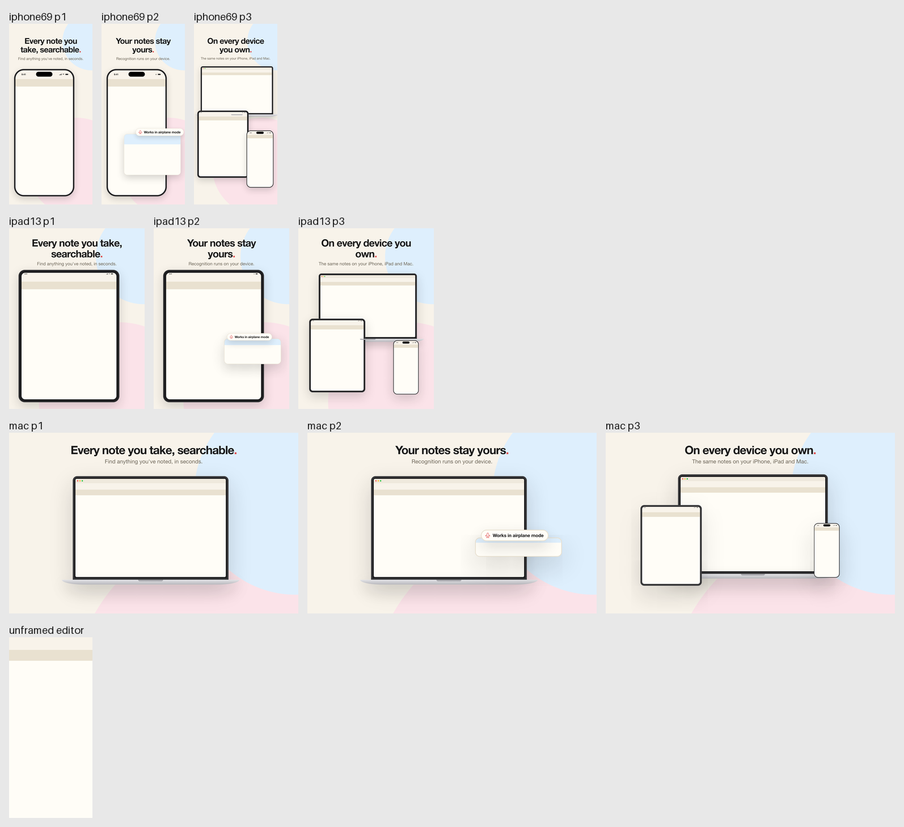

# store-shots workshop

What it takes to develop the `store-shots` skill. The skill itself, with its engine, `bin/` and
example project, ships in
[plugins/fatodono-founderkit/skills/store-shots](../../plugins/fatodono-founderkit/skills/store-shots).



## Tests

```sh
cd workshop/store-shots
uv run pytest -q
```

The tests run the real CLI over a temporary copy of the skill's example project, with real Chrome
renders, and take about two minutes. They import the engine from the plugin folder
(`pyproject.toml` sets the path), so nothing is installed into the plugin.

The example's fake adapter (`example/adapter/fake_adapter.py`) keeps the adapter contract the way a
real adapter does. `FAKE_ADAPTER_BREAK` makes it break one rule at a time, and
`tests/test_adapter.py` checks that each broken rule fails its own gate in `adapter test`.

## How the skill runs on a user's machine

Everything runs through uv, so it works the same on Windows, macOS and Linux with no shell
script. `bin/store-shots.py` is a uv script (`uv run --script`) that pins Pillow and PyYAML in its
header, puts `engine/` on the path and writes no bytecode. uv keeps Python and the dependencies
in its own cache, so nothing is written inside the skill folder, which may be a versioned plugin
cache or a skills folder in the user's repo. The starter adapter `init` writes and the example's
fake adapter are uv scripts too. The engine reads and writes every text file as UTF-8, and finds
Chrome, Chromium or Edge in their standard install folders before searching the `PATH`.

The `store-shots` workflow runs the tests on Ubuntu, Windows and macOS.
